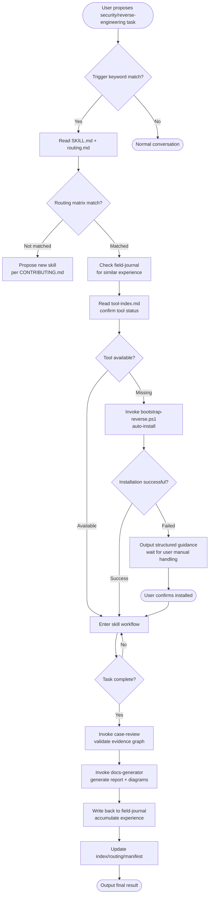
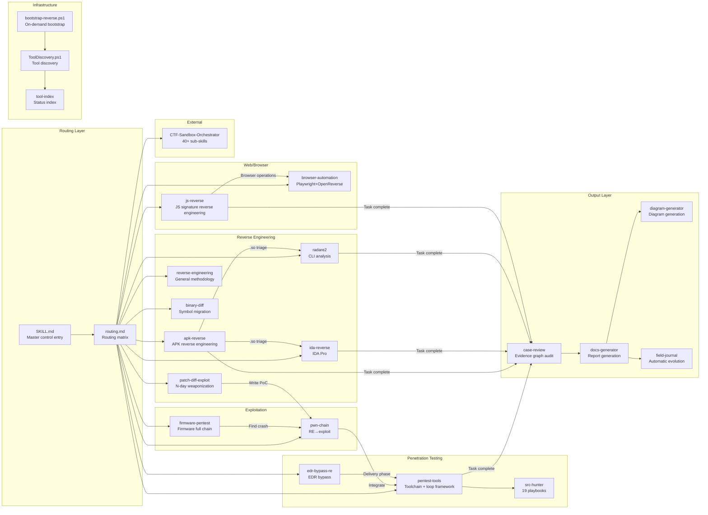
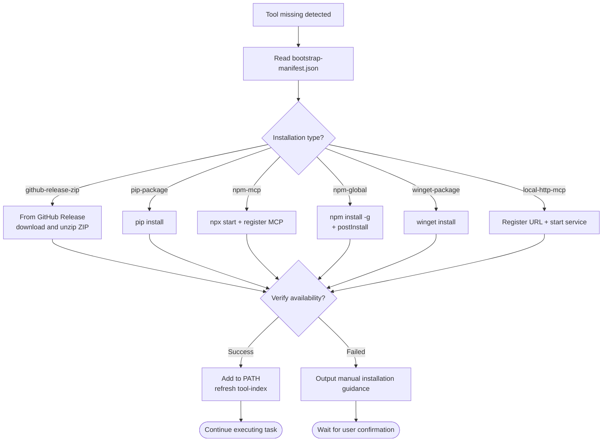
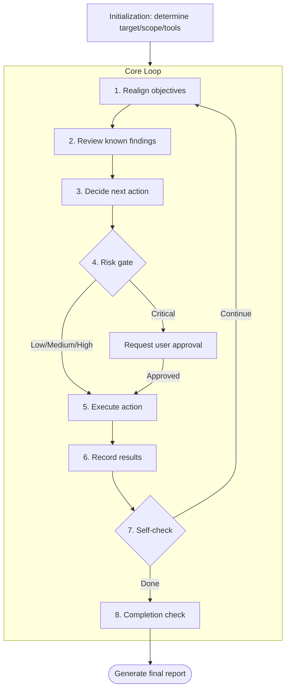
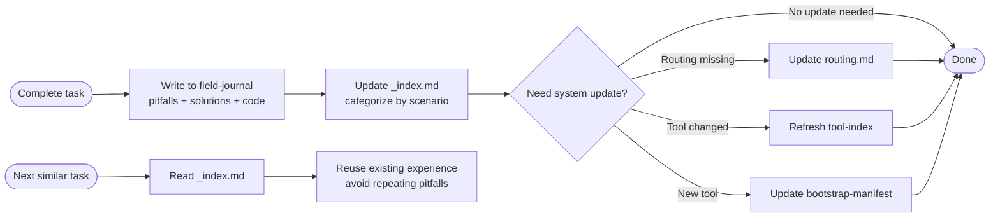
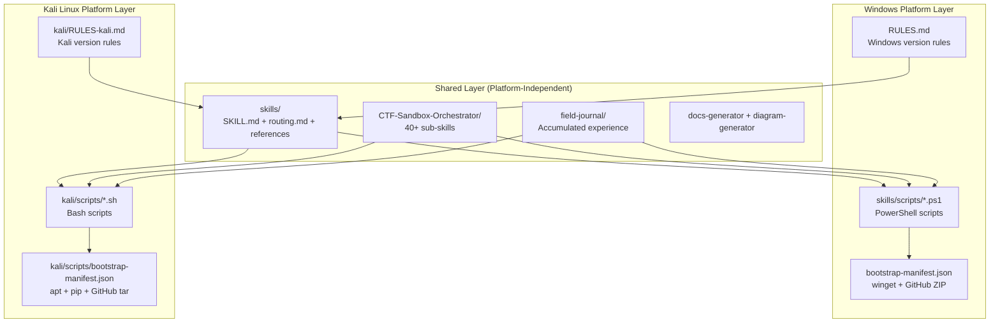
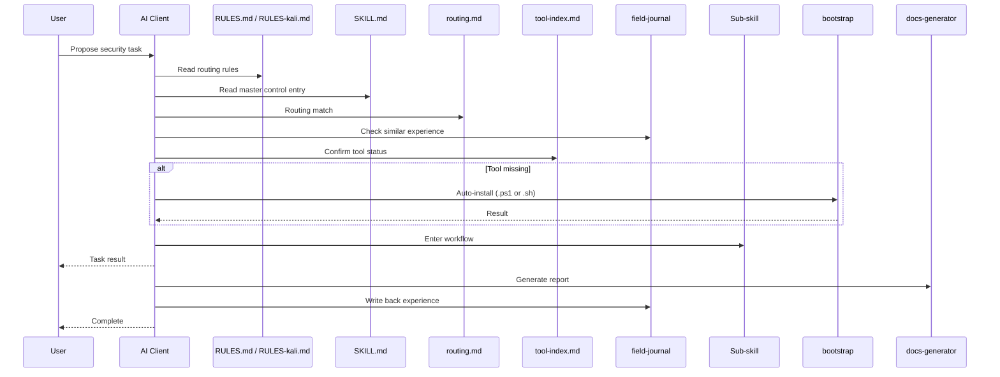

# System Architecture Diagram

## Complete Behavior Chain Flowchart

## Skills Module Relationship Diagram

## Bootstrap Process

## Penetration Testing Loop

## Automatic Evolution Mechanism

## Multi-Platform Support Architecture

### Platform Selection Logic

| Environment | Rule file used | Scripts used | Package management |
|------|--------------|-----------|--------|
| Windows | `RULES.md` | `skills/scripts/*.ps1` | winget / GitHub Release ZIP |
| Kali Linux | `kali/RULES-kali.md` | `kali/scripts/*.sh` | apt / pip / npm / GitHub tar.gz |

### Kali Version Features

- **Many pre-installed tools**: nmap, sqlmap, hashcat, hydra, metasploit, radare2, binwalk, burpsuite, etc. require no bootstrap
- **Unified apt management**: no winget needed, no manual ZIP extraction needed
- **Native bash**: simpler scripts, no PowerShell dependency
- **Path conventions**: `/usr/bin/`, `/opt/`, `~/tools/`, no drive letters or space issues

## File Reading Sequence Diagram

