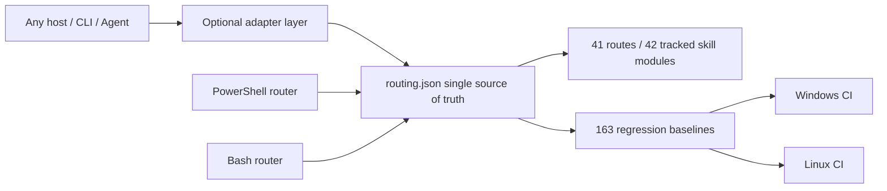

# PR #43 / #37 / #36 / #23 Local Review and Integration Report

- Date: 2026-08-08
- Baseline: `origin/main` at `6315d02`
- Review branch: `codex/review-pr-43-37-36-23`
- Scope: review only the incremental value of the four PRs relative to the current mainline; do not execute actions against external targets
- Conclusion: all four PRs have reusable value, but only #43 and #37 are suitable for retaining their main body; #36 and #23 must be selectively integrated

## Executive Summary

| PR | Value relative to mainline | Integration decision | Key boundary |
|---|---|---|---|
| #43 | Very high | Retain structured routing, 163 current regression baselines, dual-platform CI, supply-chain pin gate, dynamic index | Remove OpenCode configuration, installers, and dedicated agents; the core must not bind to any client |
| #37 | High | Merge case-review, evidence graph review, hash verification, and unit tests, and add R40 | Accept both `done` and the currently agreed `completed` |
| #36 | Medium-high | Selectively merge Burp reconnect/newline message handling, atomic token, Anything Analyzer authentication, process tree and sudo home fixes | Reject semantic regressions such as "all capabilities are always ready" |
| #23 | Medium (low overall) | Merge only Bash case-init, case-guard, structured Bash routing, and CI parity | Exclude the client manifest, GIFs, demo artifacts, and hardcoded routing copies among the 92 files |

## Platform Boundary

The single source of truth for structured routing is `skills/config/routing.json`. Both the PowerShell and Bash entry points read that file; host clients may only exist as optional adapters and must not determine repository identity, routing rules, test baselines, or installation paths.

## Review Findings and Corrections

1. The design value of #43 comes from structured data and automated gates, not from OpenCode integration. All OpenCode-specific files and CI jobs have been removed.
2. The original #37 implementation only recognized `done`, which would misjudge the mainline's use of `completed` as incomplete; compatibility and a seventh unit test have been added.
3. The bridge reconnection and token writing in #36 are a net gain; its capability-status rewrites would create false positives and were not merged.
4. The Bash router in #23 copied a hardcoded table verbatim, which would immediately drift from #43's R40/priority; it has been rewritten to read `routing.json`, and CI validates R1/R3/R40 parity.
5. The new supply-chain gate exposed 7 floating install sources in the Kali manifest. Frida 14.10.4, the IDA MCP commit, Agent Browser 0.31.1, the ProxyCat commit, Nuclei v3.8.0, and pwntools 4.15.0 have been pinned, and the install commands now actually use these pins.
6. A mandatory re-review after pushing found that Bash `case-init` did not inherit the CaseName path constraints; paths, control characters, wildcards, and trailing dots/spaces are now rejected, and negative CI has been added.
7. Bash's authorization URL previously fell incorrectly into `offline` and could be ready; it has been aligned with PowerShell as `authorized_target_only`, clarifying that offline accepts only local samples.
8. Bash `case-guard` now reads values only from the `auth`, `network_profile`, and `signoff` sections; fake fields in notes/evidence cannot pass the gate.
9. The Kali ProxyCat pinned source install now generates a discoverable `~/.local/bin/proxycat` wrapper; the CI checkout has also been pinned from a mutable tag to the v4.2.2 commit.
10. The original dynamic INDEX mistakenly included 12 local modules excluded by `.gitignore` on the development machine, so a clean clone would fail; the generator now enumerates only Git-tracked skills, and both a clean clone and a workspace with private extensions consistently produce 42 core modules.

## Quantified Improvement over the Old Mainline

Using the same set of 163 baselines to invoke both the old mainline hardcoded router and the new structured router, each in a separate PowerShell process:

| Version | Passed | Accuracy | No output |
|---|---:|---:|---:|
| Old mainline `6315d02` | 137 / 163 | 84.05% | 0 |
| Current structured implementation | 163 / 163 | 100% | 0 |

An absolute increase of 26 correct routes and an improvement of 15.95 percentage points. The improvement covers scenarios where the old implementation would fall back to R0, including Frida/Android, certificate and root detection, packet capture replay, ransomware, Burp/Metasploit, Go binaries, BLE, USB, native `.so`, and memory dumps.

## Verification Results

| Verification item | Result |
|---|---|
| Full structured routing regression | 163 / 163 passed |
| Routing consistency and supply-chain pin gate | Passed |
| PowerShell smoke | Passed |
| P0 friction / scope-guard regression | Passed |
| Old/new 163 A/B | 137/163 → 163/163 |
| case-review Python unit tests | 7 / 7 passed |
| Burp bridge Node regression | 1 / 1 passed |
| Bash router/case-init/case-guard parity | Passed |
| PowerShell, Bash syntax and JSON parsing | Passed |
| Java compile check | Gradle 8.7 distribution download was blocked by the local certificate-revocation network; switched to declared dependencies from Maven Central and JDK 21, and `McpHttpServer.java` compiled successfully |

## Remaining Risks

- Bash structured routing depends on Python 3; this is an explicit runtime dependency, but it avoids a second routing table.
- Pinned dependency versions require periodic, explicit upgrades instead of implicitly following `latest`.
- Client adapters can continue to expand, but the core data and tests must remain fully host-agnostic.
- Gradle task-level tests were not completed on this machine; the 128 MB wrapper distribution download was blocked by the certificate-revocation network and a slow link, so a standalone compile check of the changed Java source files was completed using same-version dependencies.

## Final Recommendation

Merge the selective results of the current review branch, not the original whole-package forms of the four PRs. Future PRs should be split by "core routing / host adaptation / demo assets / documentation" to facilitate independent review and rollback.
