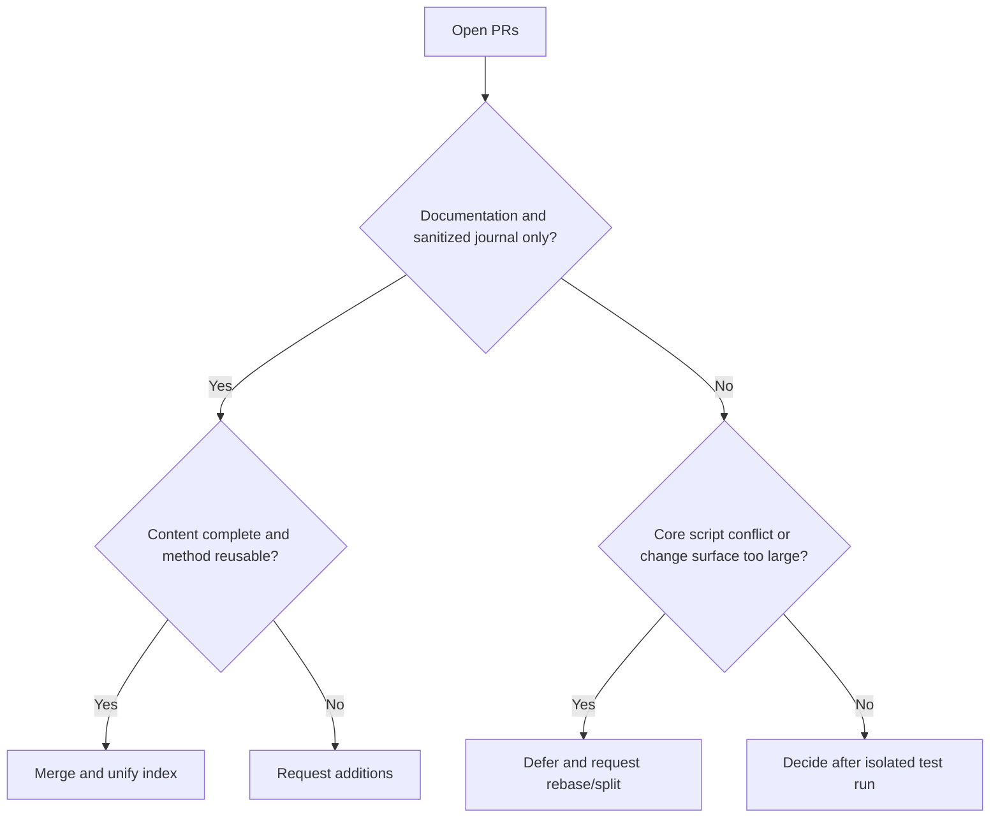

# 2026-08-08 Open PR Value Assessment and Merge Report

## Conclusion

Reviewed 8 open PRs based on the latest `origin/main`. This round merged #59, #19, #22, and #29; deferred #43, #37, #36, and #23. The post-merge smoke and routing coherence checks both passed.

## Assessment Results

| PR | Value | Risk/Status | Decision |
|---|---|---|---|
| #59 | Rust cdylib differential reproduction method is complete and highly reusable | Journal and index only, no executable code | Merge |
| #19 | Broad coverage of Windows 24H2 toolchain compatibility experience | Journal and index only | Merge |
| #22 | Electron/Bytenode/update chain analysis method is complete | Journal and index only | Merge |
| #29 | Next.js dual API serializer and contract reconstruction experience is complete | Journal and index only | Merge |
| #43 | Routing single source of truth, regression baselines, CI, and version pinning are highly valuable; client integration can only serve as an optional adapter layer | 38 files, conflicts with 4 key mainline files, original proposal includes OpenCode-specific configuration | Defer; recommend a dedicated review after rebase; the core must not bind to OpenCode |
| #37 | Evidence graph/case review can complete delivery auditing | Conflicts with mainline routing validation and documentation | Defer; recommend running its unit tests after rebase |
| #36 | MCP/bootstrap security hardening direction is correct | 6 key file conflicts; some capabilities have already been absorbed by the recent mainline | Defer; perform differential deduplication |
| #23 | Bash parity and presentation materials have ecosystem value | 92 files, many presentation assets, 2 script conflicts | Defer; recommend splitting the PR |

## Decision Diagram

## Verification

- `skills/scripts/smoke.ps1`: ALL PASS (9 script parses, 8 routing cases).
- `skills/scripts/verify-routing-coherence.ps1`: ALL ROUTING COHERENCE CHECKS PASSED.
- The user's original uncommitted journal was isolated and preserved via stash during synchronization and merging, then restored.

## Follow-up Recommendations

1. Prioritize rebasing #43 onto the current `main`, focusing on JSON routing equivalence, supply-chain pin gate, and cross-platform paths.
2. Rebase #37 separately and run `skills/case-review/tests/test_review_case.py`.
3. Compare #36 file by file against already-merged security fixes and extract only tests or edge-case handling not yet covered.
4. Split #23 into three independent PRs: Bash parity, plugin metadata, and demo assets.
